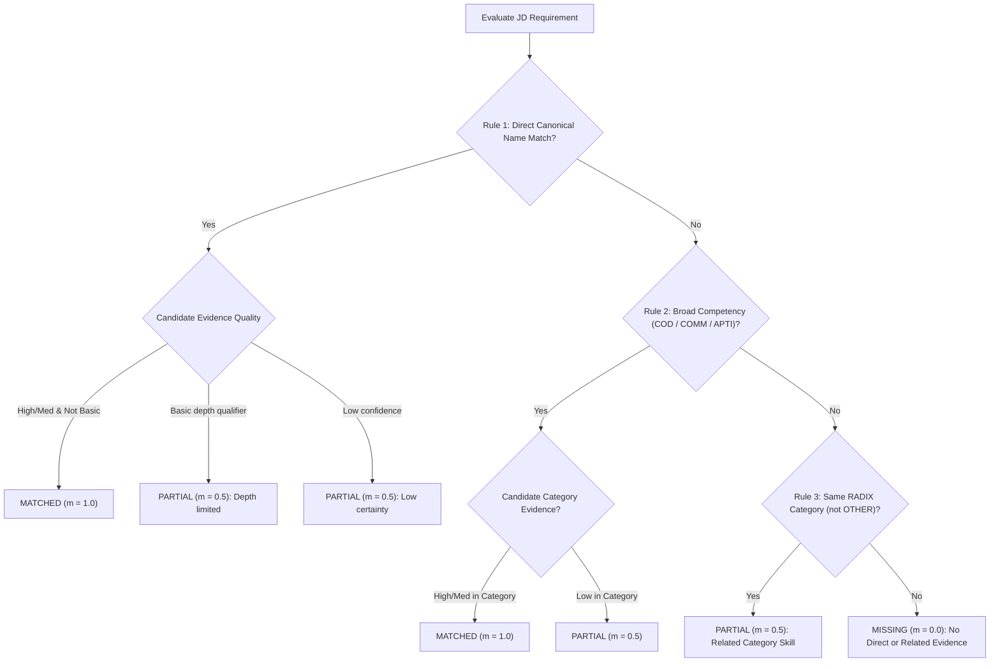

# RADIX Talent Match — Scoring Rules & Specification

Document Owner: **Akshat Mehra** (Scrum Master & Skill Matching Lead)  
Status: **Provisional Defaults Implemented (Subject to Final Team Agreement)**  
Backend Implementation: `backend/app/services/skill_matcher.py`  
Frontend Implementation: `frontend/src/utils/skillMatcher.js`

---

## 1. Skill Matching Architecture & Objectives

Skill Matching answers the job-specific question:
> **"How well does this candidate fit this specific job posting?"**

This is fundamentally distinct from Talent Check, which asks:
> **"How ready is this candidate for this company's baseline expectations across all 12 RADIX skillsets?"**

A candidate can have a high Talent Check score for Google while having a low Skill Matching score for a Data Scientist role if their skills are software engineering-focused.

---

## 2. Mathematical Scoring Formula

Skill Matching uses a weighted score based on each JD requirement's assigned weight and the classification outcome:

$$\text{Match Score} = \text{round}\left(100 \times \frac{\sum_{i=1}^N (w_i \times m_i)}{\sum_{i=1}^N w_i}, 2\right)$$

Where:
- $N$ = Number of deduplicated JD skill requirements.
- $w_i$ = Importance weight for requirement $i$.
- $m_i$ = Match value achieved by candidate for requirement $i$.

### Configurable Scoring Weights & Values

| Parameter | Provisional Default | Description | Status |
|---|---|---|---|
| **Full Match Value ($m_{\text{matched}}$)** | `1.0` | Exact canonical skill match with high/medium evidence certainty, or broad competency match. | **Agreed** |
| **Partial Match Value ($m_{\text{partial}}$)** | `0.5` | Depth-qualified match (e.g. basic), low-confidence evidence, or related skill in the same category. | **Provisional (Requires Team Approval)** |
| **Missing Match Value ($m_{\text{missing}}$)** | `0.0` | No direct or related evidence found in profile. | **Agreed** |
| **Required Skill Weight ($w_{\text{required}}$)** | `1.0` | Applied to core requirements from "Responsibilities" or "What We're Looking For". | **Provisional (Requires Team Approval)** |
| **Preferred Skill Weight ($w_{\text{preferred}}$)** | `0.5` | Applied to "Nice to Have" or secondary requirements. | **Provisional (Requires Team Approval)** |

> [!NOTE]
> All results persist the scoring parameters (`scoring.weights` and `scoring.partial_value`) to guarantee reproducibility.

---

## 3. Four-Tier Classification Logic

Each JD requirement is evaluated against the candidate's skills using the first rule that matches in priority order:

### Detailed Rules
1. **Rule 1 — Direct Canonical Name Match:**
   - Evaluated after case normalization, punctuation stripping, and alias mapping (e.g., "PostgreSQL" ➔ "sql", "OOPS" ➔ "object-oriented design").
   - If candidate evidence confidence is `high` or `medium` and does not contain depth qualifiers ("basic", "introductory") when JD requires standard depth ➔ **`matched` ($1.0$)**.
   - If candidate's evidence qualifies the skill as basic-level ("basic", "fundamentals", "exposure") ➔ **`partial` ($0.5$)**.
   - If candidate's evidence is only `low` confidence ➔ **`partial` ($0.5$)** due to evidence uncertainty.

2. **Rule 2 — Broad Competency Match:**
   - JD skills describing a broad capability rather than a specific tool:
     - `"Programming"` / `"Coding"` ➔ Maps to `COD`. Satisfied by any strong coding language (e.g., Python, C++, Java).
     - `"Communication"` ➔ Maps to `COMM`.
     - `"Quantitative Aptitude"` ➔ Maps to `APTI`.
   - Strong category evidence ➔ **`matched` ($1.0$)**; low-confidence only ➔ **`partial` ($0.5$)**.

3. **Rule 3 — Related Category Evidence:**
   - Candidate lacks the specific tool, but has demonstrable skills in the same RADIX category (excluding `OTHER`).
   - Example: JD asks for "CI/CD" (SWE category). Candidate lists "Unit Testing" (SWE category). Direct match fails, but related category evidence exists ➔ **`partial` ($0.5$)**.

4. **Rule 4 — Missing Requirement:**
   - No direct match and no related category skills ➔ **`missing` ($0.0$)**.

---

## 4. Evidence, Confidence & Quality Rules

1. **Extraction Confidence $\neq$ Candidate Proficiency:**
   - `confidence` measures how certain the extractor was about the presence of evidence in the source document (`high`, `medium`, `low`). It is never shown as a proficiency rating.
2. **Deduplication Without Double-Counting:**
   - Multiple candidate mentions of the same canonical skill (e.g. "Python" and "Python 3") are merged before scoring. The highest confidence is retained and evidence phrases are concatenated.
3. **Empty Requirements & Zero-Division Safety:**
   - If a JD has no extracted skills or the total weight is zero, the system returns `match_score = null` and `scoring_status = "not_scored"`. It never produces a synthetic score or divides by zero.

---

## 5. Three Hand-Calculated Scoring Examples

### Example 1: Full-Stack SWE Match (Ananya Rao vs. Google SWE)
- **Candidate Profile:** Ananya Rao (`prf_sample_ananya`)
  - Skills: C++ (COD, high), Java (COD, high), Python (COD, med), DSA (DSA, high), OS (OS, high), Linux (OS, med), Computer Networks (NETW, med), OOD (OOD, high), System Design (SYSD, med), SWE Practices (SWE, med), Git (SWE, med), Communication (COMM, low).
- **Job Description:** Google LLC — Software Engineer (`jd_sample_google_swe`)
  - 6 Required Skills ($w=1.0$), 1 Preferred Skill ($w=0.5$).
  - Total Weight: $6 \times 1.0 + 1 \times 0.5 = 6.5$.

| Requirement | Category | Type | Weight | Candidate Classification & Evidence | Match Value | Weighted Earned |
|---|---|---|---|---|---|---|
| **Data Structures & Algorithms** | DSA | Required | 1.0 | Rule 1: High-confidence CP problems solved | 1.0 | $1.0 \times 1.0 = 1.0$ |
| **Programming** | COD | Required | 1.0 | Rule 2: Broad COD satisfied by C++ & Java (high) | 1.0 | $1.0 \times 1.0 = 1.0$ |
| **Object-Oriented Design** | OOD | Required | 1.0 | Rule 1: High-confidence parking-lot design patterns | 1.0 | $1.0 \times 1.0 = 1.0$ |
| **Operating Systems** | OS | Required | 1.0 | Rule 1: High-confidence process scheduling simulation | 1.0 | $1.0 \times 1.0 = 1.0$ |
| **System Design** | SYSD | Required | 1.0 | Rule 1: Medium-confidence URL shortener with Redis | 1.0 | $1.0 \times 1.0 = 1.0$ |
| **Software Engineering Practices**| SWE | Required | 1.0 | Rule 1: Medium-confidence rate limiter in production | 1.0 | $1.0 \times 1.0 = 1.0$ |
| **Communication** | COMM | Preferred | 0.5 | Rule 1: Low-confidence mentoring junior students | 0.5 | $0.5 \times 0.5 = 0.25$ |

- **Sum of Weighted Earned:** $1.0 + 1.0 + 1.0 + 1.0 + 1.0 + 1.0 + 0.25 = 6.25$.
- **Calculation:**
  $$\text{Match Score} = \text{round}\left(100 \times \frac{6.25}{6.5}, 2\right) = \text{round}(96.1538..., 2) = \mathbf{96.15}$$
- **Result:** $96.15 / 100$ (Strong Match). Tested in `test_hand_calculated_example_1_ananya_vs_google_swe`.

---

### Example 2: Partial & Missing Gaps (Rohan Verma vs. Google SWE)
- **Candidate Profile:** Rohan Verma (`prf_sample_rohan`)
  - Skills: Python (basic) (COD, low), Communication (COMM, med), Quantitative Aptitude (APTI, med).
- **Job Description:** Google LLC — Software Engineer (`jd_sample_google_swe`)
  - Total Weight: $6.5$.

| Requirement | Category | Type | Weight | Candidate Classification & Evidence | Match Value | Weighted Earned |
|---|---|---|---|---|---|---|
| **Data Structures & Algorithms** | DSA | Required | 1.0 | Rule 4: Missing (no DSA evidence) | 0.0 | $1.0 \times 0.0 = 0.0$ |
| **Programming** | COD | Required | 1.0 | Rule 2: Low-confidence Python (basic) in COD | 0.5 | $1.0 \times 0.5 = 0.5$ |
| **Object-Oriented Design** | OOD | Required | 1.0 | Rule 4: Missing (no OOD evidence) | 0.0 | $1.0 \times 0.0 = 0.0$ |
| **Operating Systems** | OS | Required | 1.0 | Rule 4: Missing (no OS evidence) | 0.0 | $1.0 \times 0.0 = 0.0$ |
| **System Design** | SYSD | Required | 1.0 | Rule 4: Missing (no SYSD evidence) | 0.0 | $1.0 \times 0.0 = 0.0$ |
| **Software Engineering Practices**| SWE | Required | 1.0 | Rule 4: Missing (no SWE evidence) | 0.0 | $1.0 \times 0.0 = 0.0$ |
| **Communication** | COMM | Preferred | 0.5 | Rule 1: Medium-confidence class representative | 1.0 | $0.5 \times 1.0 = 0.5$ |

- **Sum of Weighted Earned:** $0.0 + 0.5 + 0.0 + 0.0 + 0.0 + 0.0 + 0.5 = 1.00$.
- **Calculation:**
  $$\text{Match Score} = \text{round}\left(100 \times \frac{1.00}{6.5}, 2\right) = \text{round}(15.3846..., 2) = \mathbf{15.38}$$
- **Result:** $15.38 / 100$ (Low Match). Tested in `test_hand_calculated_example_2_rohan_vs_google_swe`.

---

### Example 3: Mixed Weights, Aliases & Related Category Evidence
- **Candidate Profile:** Dev X
  - Skills: Design Patterns (OOD, high), MySQL (SQL, high), Unit Testing (SWE, med).
- **Job Description:** Tech Innovations — Systems Developer
  - Requirements:
    1. "OOP" (OOD, Required, $w=1.0$)
    2. "PostgreSQL" (SQL, Required, $w=1.0$)
    3. "Azure" (CLOUD, Preferred, $w=0.5$)
    4. "Incident Management" (SWE, Preferred, $w=0.5$)
  - Total Weight: $1.0 + 1.0 + 0.5 + 0.5 = 3.0$.

| Requirement | Category | Type | Weight | Classification & Evidence | Match Value | Weighted Earned |
|---|---|---|---|---|---|---|
| **OOP** | OOD | Required | 1.0 | Rule 1: Canonical alias match via "Design Patterns" | 1.0 | $1.0 \times 1.0 = 1.0$ |
| **PostgreSQL** | SQL | Required | 1.0 | Rule 1: Canonical alias match via "MySQL" | 1.0 | $1.0 \times 1.0 = 1.0$ |
| **Azure** | CLOUD | Preferred | 0.5 | Rule 4: Missing (no CLOUD evidence in profile) | 0.0 | $0.5 \times 0.0 = 0.0$ |
| **Incident Management** | SWE | Preferred | 0.5 | Rule 3: Related skill in same category ("Unit Testing" in SWE) | 0.5 | $0.5 \times 0.5 = 0.25$ |

- **Sum of Weighted Earned:** $1.0 + 1.0 + 0.0 + 0.25 = 2.25$.
- **Calculation:**
  $$\text{Match Score} = \text{round}\left(100 \times \frac{2.25}{3.0}, 2\right) = \mathbf{75.00}$$
- **Result:** $75.00 / 100$ (Strong Match). Tested in `test_hand_calculated_example_3_mixed_aliases_and_related_category`.

---

## 6. Provisional Defaults Requiring Final Team Sign-off

The following parameters are currently marked as provisional and require official team agreement before final deployment:
1. **Partial Match Value = 0.5:** Should related category evidence receive $0.5$ or a lower weight (e.g. $0.35$)?
2. **Preferred Requirement Weight = 0.5:** Is a $2:1$ ratio between Required ($1.0$) and Preferred ($0.5$) acceptable to all owners?
3. **Rounding Precision:** Backend returns 2 decimal places (e.g., $96.15$), frontend renders rounded integer ($96$). Should the API return float or integer?
